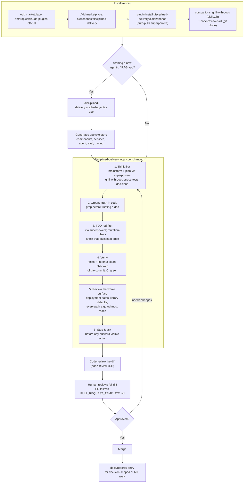

# disciplined-delivery

[](https://github.com/alezenonos/disciplined-delivery/actions/workflows/ci.yml)

A Claude Code plugin with two skills. It also installs in **GitHub Copilot** (CLI and VS Code),
which reads the same plugin format — see [GitHub Copilot](#github-copilot).

- **`disciplined-delivery`** — ship work as small, test-first, individually reviewable
  increments, with the human as the gate that commits and merges.
- **`scaffold-agentic-app`** — one-shot scaffolder for a production RAG/agentic LLM app
  (Python + FastAPI) with light placeholder code.

## How it works

Install once, then let the skills drive the workflow: scaffold a new agentic/RAG app if you
need a starting structure, then ship every change through the disciplined-delivery loop —
plan/test via `superpowers`, prove it green on a clean checkout of the exact commit, review
the whole surface (not just the diff), run `code-review-skill` over it, and hand it to a human.
The skill also ships the mechanisms that enforce its rules (a PR template with a CI checker,
and a clean-checkout local CI runner) ready to copy into any repo — see
[Adopting it in your repo](#adopting-it-in-your-repo).



## Install

### Let an agent install it

Paste this into Claude Code or GitHub Copilot (agent mode / CLI), in any directory:

```text
Install the disciplined-delivery plugin from https://github.com/alezenonos/disciplined-delivery.
Read its README "Install" section and follow the steps for the agent you are (Claude Code or
GitHub Copilot): the plugin, its superpowers dependency, and the grill-with-docs and
code-review-skill companions. Then run the verify checks for your agent and report what passed.
```

No checkout is needed: the manual and Copilot steps work from the GitHub repo name (only the
one-shot `./install.sh` runs from a checkout). The agent will ask before running commands if
your permission mode requires it.

### Claude Code — quick install (one shot)

From a checkout of this repo:

```bash
./install.sh
```

It adds both marketplaces, installs the plugin (which auto-pulls `superpowers`), and prints
the remaining companion-skill steps.

### Claude Code — manual install

Run inside Claude Code (slash commands) **or** in a terminal (prefix each with `claude `):

```bash
# 1. Make sure the official marketplace is added FIRST — `superpowers` resolves from it, and a
#    dependency from a marketplace you have not added is left unresolved. Harmless if present.
/plugin marketplace add anthropics/claude-plugins-official

# 2. Add this marketplace and install the plugin. This auto-resolves and installs
#    `superpowers` (cross-marketplace install is permitted by
#    allowCrossMarketplaceDependenciesOn in this repo's marketplace.json).
/plugin marketplace add alezenonos/disciplined-delivery
/plugin install disciplined-delivery@alezenonos

# 3. Install the grill-with-docs companion skill. It ships via skills.sh (not a Claude
#    Code plugin), so it is a separate step:
npx skills@latest add mattpocock/skills   # then select grill-with-docs

# 4. Install the code-review-skill companion (a bare skill, installed by git clone):
git clone https://github.com/awesome-skills/code-review-skill.git ~/.claude/skills/code-review-skill
```

Terminal equivalents: `claude plugin marketplace add …` and `claude plugin install …`.

### What gets installed

| Component | Source | How |
| --- | --- | --- |
| `disciplined-delivery` skill | this repo | plugin install |
| `scaffold-agentic-app` skill | this repo | plugin install |
| `superpowers` (brainstorming, writing-plans, TDD, verification) | anthropics/claude-plugins-official | auto-resolved dependency (Claude Code); separate install (Copilot) |
| `grill-with-docs` | mattpocock/skills (`skills.sh`) | `npx skills@latest add` |
| `code-review-skill` | awesome-skills (GitHub) | `git clone` into `~/.claude/skills/` |

### Verify your install

Confirm it actually works after installing:

```bash
# Plugin + its dependency are installed and enabled
claude plugin list                       # disciplined-delivery@alezenonos + superpowers, both enabled

# Companion skills are present
ls ~/.claude/skills/code-review-skill    # code-review-skill cloned
npx skills@latest list                   # lists grill-with-docs

# The bundled generator runs end to end
claude plugin validate .                 # if developing from a checkout
```

In a Claude Code session, `/disciplined-delivery:disciplined-delivery` and
`/disciplined-delivery:scaffold-agentic-app` should both autocomplete. If `superpowers` shows
as unresolved, the official marketplace was not added first (see step 1).

CI additionally runs a hermetic **install-consistency** check (`scripts/validate_manifests.py`):
it confirms cross-marketplace dependencies are allow-listed and that the marketplace actually
offers this plugin — the misconfigurations that would otherwise only surface at install time.

### GitHub Copilot

The skills are plain [Agent Skills](https://code.visualstudio.com/docs/agent-customization/agent-skills)
(`skills/<name>/SKILL.md`), and Copilot reads Claude Code's plugin layout (`.claude-plugin/`),
so nothing needs converting. Two differences from Claude Code:

- **`superpowers` is not auto-installed.** Copilot ignores the `dependencies` field in
  `plugin.json`, so install it yourself (below).
- **Invocation is by skill name** — `/disciplined-delivery`, `/scaffold-agentic-app` — not the
  `plugin:skill` form Claude Code uses. Copilot also loads them automatically when a task matches.

**Copilot CLI:**

```bash
copilot plugin marketplace add alezenonos/disciplined-delivery
copilot plugin install disciplined-delivery@alezenonos
# or, without the marketplace:  copilot plugin install alezenonos/disciplined-delivery

copilot plugin marketplace add anthropics/claude-plugins-official
copilot plugin install superpowers@claude-plugins-official

copilot plugin list   # disciplined-delivery and superpowers listed
```

**VS Code (Copilot agent mode):** run **Chat: Install Plugin From Source** from the Command
Palette with `https://github.com/alezenonos/disciplined-delivery` (agent plugins are in preview
and may be turned off by your organisation via `chat.plugins.enabled`). Or skip the plugin and
copy the skill folders into a skills directory VS Code reads — `~/.copilot/skills/` for every
project, or `.github/skills/` inside one repo.

**Copilot cloud agent:** it only sees skills committed to the repository, so copy
`skills/disciplined-delivery/` (and `scaffold-agentic-app/` if wanted) into the target repo's
`.github/skills/`.

**Companions:** `npx skills@latest add mattpocock/skills` (select `grill-with-docs`) works for
Copilot too; clone `code-review-skill` into `~/.copilot/skills/code-review-skill` (or
`~/.claude/skills/`, which VS Code also reads).

> Copilot support follows GitHub's and VS Code's documented plugin and skill formats. It is not
> yet covered by this repo's CI.

## Skills

Once installed in Claude Code, the skills are namespaced by the plugin:

- `/disciplined-delivery:disciplined-delivery`
- `/disciplined-delivery:scaffold-agentic-app`

In Copilot they are `/disciplined-delivery` and `/scaffold-agentic-app`. Both agents also load
them automatically when a task matches their description.

## Adopting it in your repo

The skill's rules are backed by mechanisms, because a rule that only people remember is not
enforced. Copy them from `skills/disciplined-delivery/assets/` (the skill tells Claude to):

| Asset | Copy to | What it enforces |
| --- | --- | --- |
| `PULL_REQUEST_TEMPLATE.md` | `.github/PULL_REQUEST_TEMPLATE.md` | problem, change, how tested (naming the commit), alternatives, known limits, single-change attestation, review boxes for behaviour-shaping and shipped changes |
| `check_pr_template.py` + `pr-template.yml` | `.github/scripts/` + `.github/workflows/` | the PR description follows the template: every section present, prose sections filled, the single-change box ticked. Rules are read from the template, so edit the template, not the script |
| `ci_local.sh` | wrap as `scripts/ci_local.sh` with the exact commands CI runs | the checks run on a clean checkout of the commit, never the working tree; `--merge-preview` tests the merge with the base; the SHA tested is printed for the PR body |

The reasoning behind every gate, with what it caught and what it costs, is in
`skills/disciplined-delivery/references/gates.md`; the rules for measuring and recording
evidence in `references/evidence.md`. This repo uses all three assets on itself.

## Layout

```
CLAUDE.md             # project memory + working principles (after Karpathy)
README.md  LICENSE  CONTRIBUTING.md  CHANGELOG.md  install.sh
pyproject.toml        # ruff + pytest config
.claude-plugin/
  plugin.json         # plugin manifest + dependencies
  marketplace.json    # marketplace catalog (self-hosts this plugin)
.github/
  workflows/ci.yml    # CI (Python 3.10-3.13 matrix; SHA-pinned actions)
  workflows/pr-template.yml  # PR description checked against the template (the shipped checker)
  dependabot.yml      # keeps the pinned actions current
  PULL_REQUEST_TEMPLATE.md
docs/
  reports/            # one task report per change (_TEMPLATE.md + dated reports)
evals/
  cases/              # per-skill eval cases (triggers / negatives / expectations)
  transcripts/        # recorded eval runs
examples/
  roman-numerals/     # worked example of the disciplined-delivery loop (lib + CLI + tests)
scripts/
  validate_manifests.py  check_evals.py
  ci_local.sh         # CI's checks on a clean checkout of HEAD (wraps the shipped runner)
skills/
  disciplined-delivery/
    SKILL.md
    references/gates.md  evidence.md   # what each gate caught and costs; evidence norms
    assets/             # PULL_REQUEST_TEMPLATE.md, check_pr_template.py, pr-template.yml,
                        # ci_local.sh — copy into a consuming repo
  scaffold-agentic-app/SKILL.md  scaffold.py  references/structure.md
tests/                # unit tests for the generator, validators and shipped assets
```

## Contributing

Anyone contributing — human or agent — follows the same rules; this repo dogfoods its own
skill. See [`CONTRIBUTING.md`](CONTRIBUTING.md).

## Development

CI (`.github/workflows/ci.yml`) runs on every push and PR. Reproduce it locally on a **clean
checkout of the commit** (the working tree does not count; quote the SHA it prints in the PR):

```bash
pip install ruff pytest pytest-cov
scripts/ci_local.sh --merge-preview   # steps 1-2 below, in a temp checkout of HEAD merged with origin/main
```

The individual steps:

```bash
# 1. Lint and unit-test this repo's own tooling (with the coverage gate CI enforces)
pip install ruff pytest pytest-cov
ruff check .
COVERAGE_PROCESS_START="$PWD/pyproject.toml" pytest -q --cov --cov-report=term-missing
# threshold (fail_under) lives in [tool.coverage.report] in pyproject.toml;
# COVERAGE_PROCESS_START is needed because the tests spawn subprocesses.

# 2. Validate plugin/marketplace manifests, skill frontmatter, and eval cases
python scripts/validate_manifests.py
python scripts/check_evals.py

# 3. Authoritative manifest check (requires the Claude Code CLI)
claude plugin validate .

# 4. Scaffold generator self-test: generate, compile, prove idempotency, test
python skills/scaffold-agentic-app/scaffold.py /tmp/app
python -m compileall -q /tmp/app
python skills/scaffold-agentic-app/scaffold.py /tmp/app   # re-run: created: 0 file(s)
( cd /tmp/app && pip install -r requirements.txt && pytest -q )
```

A change is not done until CI is green on the branch.

## Evaluating skills

Skills are behavior-shaping code, so they are evaluated. [`evals/`](evals/README.md) holds a
case file per skill (the prompts that should auto-trigger it, the ones that shouldn't, and the
behaviours to verify). CI gates the cases (`scripts/check_evals.py` — every skill must have one);
running the cases against a live session and committing the transcript is a manual step, because
auto-triggering can't be exercised in hermetic CI. Changing a skill's wording requires a fresh
eval run.
